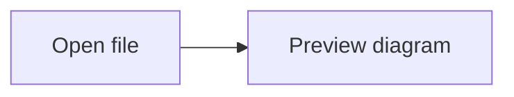

# 📝 Markdown Open

An offline Markdown and Mermaid viewer built with **Tauri + Rust**, **React**, and
**TypeScript**. Available as a macOS desktop app or a standalone web app.

## Features

- Markdown preview with tables, code fences, and syntax highlighting.
- Offline Mermaid diagrams with light/dark themes and source fallback for invalid diagrams.
- Native file/folder selection and a recursive Markdown workspace explorer.
- Local Markdown links resolved relative to the current document.
- Finder **Open With**, including when the app is closed or its window is hidden.
- Native file drops, including onto an already-open document.
- System light/dark theme and PDF export through the macOS print dialog.
- Browser mode for opening local files without installing the desktop app.

## Development

### Prerequisites

- Node.js 22.12+ and npm.
- A current stable Rust toolchain installed with [rustup](https://rustup.rs/).
- macOS 11+ with Xcode Command Line Tools (or Xcode) for desktop builds.
- This release workflow targets Apple Silicon (`aarch64-apple-darwin`).

```bash
git clone https://github.com/yusriyadi/markdown-open.git
cd markdown-open
npm ci
```

### Desktop

```bash
npm run desktop:dev
```

This starts Vite and the Tauri desktop shell. Rust handles filesystem operations,
OS file-open events, native dialogs, and printing. React, markdown-it, highlight.js,
and Mermaid run inside the system WKWebView. The installed app needs no Node.js,
Rust installation, development server, or internet for its core features.

### Web

```bash
npm run dev
npm run build
npm run preview
```

The web build is written to `dist/`. File selection and drag/drop use browser APIs;
Open Folder, Finder integration, and desktop filesystem navigation are available
in the desktop app. PDF export uses the browser print dialog in web mode.

## Build macOS Distribution

```bash
rustup target add aarch64-apple-darwin
npm run desktop:build
```

Outputs in `release/tauri-arm64/`:

- `Markdown Open.app`
- `Markdown Open-1.0.0-arm64.dmg`
- `Markdown Open-1.0.0-arm64-mac.zip`

Open the DMG and drag the application to Applications. This replaces the previous
app only if you choose to do so. Finder file associations are registered by the
bundle; users choose their preferred default viewer in macOS.

The packaging script records exact DMG, ZIP, and installed app sizes in
`docs/tauri-size-report.json`, comparing them with the preserved Electron baseline.
The old Electron artifacts remain separate in `release/` on the development machine.

Signing and notarization require an appropriate Apple Developer identity and
credentials. Local builds without those credentials are not notarized for public
release; macOS may block first launch of a downloaded copy. Do not treat an unsigned
local build as an Apple-verified distribution.

## Usage

1. Click **Open File**, drop a `.md`/`.markdown` file, or use Finder **Open With**.
2. Click **Open Folder** to browse a Markdown workspace.
3. Click a sidebar file or a local Markdown link to navigate.
4. Click **Export PDF**, then choose the macOS PDF save option in the print dialog.
5. Closing the window keeps the app available in the Dock. Use **Quit** to exit.

Export waits for Mermaid rendering and document fonts. The native print dialog
owns the save/print/cancel interaction; cancelling preserves the open document.
Images explicitly referenced from remote sites still require internet access.

### Mermaid

Use a fenced `mermaid` block:

````markdown

````

See `sample.md` for flowchart and sequence diagram examples. Diagram scripts are
bundled locally and loaded only for documents containing Mermaid blocks.

## Validation

```bash
npm test
npm run test:rust
npm run build
```

Rust tests exercise document permissions, empty/Unicode files, relative links,
workspace filtering/order, symlink handling, and queued file-open requests.
Frontend tests cover stale loads, cancellation, the native event inbox lifecycle,
and Markdown source escaping. A DOM integration test also checks browser file loading, empty documents, and error preservation without Tauri. Native smoke testing must use the packaged macOS
application: Finder cold/warm opens, native drops/dialogs, and real PDF output
cannot be proven by a Chromium-only test.

## Architecture

| Layer | Technology |
|---|---|
| Desktop runtime | Tauri 2 + Rust |
| macOS rendering | System WKWebView |
| UI | React 18 + TypeScript + CSS |
| Frontend build | Vite |
| Markdown / code | markdown-it / highlight.js |
| Diagrams | Mermaid, bundled for offline use |
| PDF | Native WKWebView print operation; browser printing in web mode |
| Tests | Rust tests with temporary filesystem fixtures; Vitest |

The Rust document service grants access through native dialogs, Finder/drop events,
and navigation from an already-authorized document. Workspace scans skip symlinks,
`.git`, and `node_modules`. The local main window has a narrow Tauri capability;
remote pages are not granted the desktop command interface.

The migration scope and acceptance checklist are in
[the PRD](docs/PRD-tauri-rust-migration.md). Measured results and remaining manual
coverage are recorded in [migration validation](docs/migration-validation.md).

## License

MIT
