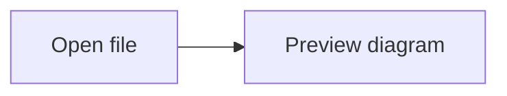

# 📝 Markdown Open

Open, preview, and export Markdown files — as a **web app** or **native macOS `.app`**.

   

## Features

- 🔍 **Live preview** — GitHub-flavored Markdown with syntax highlighting
- 📊 **Mermaid diagrams** — Render fenced `mermaid` blocks offline with light/dark themes
- 📂 **Workspace explorer** — Browse all `.md` files in a folder tree (Electron)
- 🔗 **Clickable links** — Navigate between local `.md` files
- 🌓 **Dark mode** — Auto follows system preference
- 📄 **Export PDF** — Native browser print (⌘P → Save as PDF)
- 📱 **Responsive** — Works on any screen size
- 🖥️ **Open With** — Set as default `.md` viewer on macOS

## Quick Start

### Web App

```bash
git clone https://github.com/yusriyadi/markdown-open.git
cd markdown-open

npm install
npm run dev          # → http://localhost:5173
```

### Electron (Desktop App)

```bash
npm install
npm run electron:dev     # Vite hot reload + Electron window
```

## Build

### Web App → `dist/`

```bash
npm run build
```

Output: static HTML/CSS/JS. Deploy ke **Vercel, Netlify, GitHub Pages**, atau server apapun.

```bash
# Example: deploy to Vercel
npx vercel --prod
```

### macOS `.app` → `release/`

```bash
npm run electron:build
```

Output:
- `release/Markdown Open-1.0.0-arm64.dmg` (installer)
- `release/Markdown Open-1.0.0-arm64-mac.zip`
- `release/mac-arm64/Markdown Open.app`

Install by opening `.dmg` and dragging to `/Applications`.

## Usage

### Web App

1. Open `http://localhost:5173`
2. Drag a `.md` file onto the drop zone — or click **Open File**
3. Preview renders instantly
4. Click **Export PDF** → browser print dialog → Save as PDF

### Desktop App (Electron)

1. Open **Markdown Open.app**
2. Click **📂 Open Folder** → pick a directory
3. Sidebar shows all `.md` files in the tree
4. Click any file → preview on the right
5. Click `.md` links in the preview → navigate between files
6. **macOS integration:** right-click any `.md` → Open With → Markdown Open

### Mermaid Diagrams

Use a fenced code block with the `mermaid` language:

````markdown

````

Diagrams render locally without an internet connection and follow the system theme.
Invalid diagrams show a message and the original code. PDF export waits for diagrams
to finish rendering. See `sample.md` for flowchart and sequence diagram examples.

## Scripts

| Script | Description |
|---|---|
| `npm run dev` | Web dev server (Vite) |
| `npm run build` | Build web app → `dist/` |
| `npm run preview` | Preview built web app |
| `npm run electron:dev` | Electron dev (Vite + Electron) |
| `npm run electron:build` | Build `.dmg` + `.app` → `release/` |

## Tech Stack

| Layer | Tech |
|---|---|
| Framework | React 18 + TypeScript |
| Bundler | Vite 6 |
| Markdown | `markdown-it` (GFM, linkify, typographer) |
| Syntax | `highlight.js` (190+ languages) |
| PDF export | Browser native `window.print()` |
| Desktop | Electron 42 + electron-builder |

## Project Structure

```
markdown-open/
├── electron/
│   ├── main.cjs         # Electron main process
│   └── preload.cjs      # IPC bridge (contextBridge)
├── src/
│   ├── App.tsx          # Root layout + state
│   ├── App.css          # Styles (light/dark/print)
│   ├── main.tsx         # React entry
│   ├── electron.d.ts    # TypeScript types for IPC
│   ├── components/
│   │   ├── Header.tsx       # Toolbar
│   │   ├── Sidebar.tsx      # File tree (Electron)
│   │   ├── FileDropZone.tsx # Drag & drop
│   │   └── PreviewPane.tsx  # Markdown renderer
│   └── lib/
│       ├── markdown.ts      # markdown-it config
│       ├── highlight.ts     # highlight.js setup
│       └── export-pdf.ts    # window.print() trigger
├── assets/
│   └── icon.svg, icns   # App icon
├── sample.md            # Demo file
├── package.json
└── vite.config.ts
```

## License

MIT
