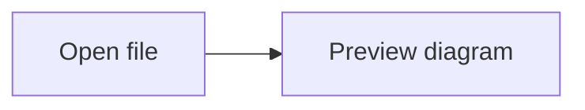

# 📝 Markdown Open

An offline Markdown and Mermaid viewer built with **Tauri + Rust**, **React**, and
**TypeScript**. Available as a macOS desktop app or a standalone web app.
Tauri also supports Windows installers; this repository's Windows build is still
experimental and has not been built or tested on Windows.

## Platform Support

| Platform | Distribution | Project status |
|---|---|---|
| macOS Apple Silicon | `.app`, `.dmg`, `.zip` | Built and smoke-tested on the development Mac |
| macOS Intel / Universal | `.app`, `.dmg` | Tauri build commands provided below; not tested for this project |
| Windows x64 | NSIS `-setup.exe`, WiX `.msi` | Experimental build preparation below; Windows feature parity is pending |
| Web | Static `dist/` | Builds independently of the desktop shell |

Build macOS releases on macOS, and use a Windows machine or Windows CI runner for
Windows installers. Changing the Rust target alone does not install the target OS
SDKs or packaging tools. Tauri documents NSIS cross-compilation as an advanced
fallback; `.msi` packaging requires Windows. See the official
[Windows installer guide](https://v2.tauri.app/distribute/windows-installer/).

## Features

- Markdown preview with tables, code fences, and syntax highlighting.
- Offline Mermaid diagrams with light/dark themes and source fallback for invalid diagrams.
- Per-diagram zoom controls and two-way scrolling for wide or tall diagrams.
- Native file/folder selection and a recursive Markdown workspace explorer.
- Local Markdown links resolved relative to the current document.
- Finder **Open With**, including when the app is closed or its window is hidden.
- Native file drops, including onto an already-open document.
- System light/dark theme and PDF export through the macOS print dialog.
- Browser mode for opening local files without installing the desktop app.

## Development

### Prerequisites

- Node.js 22.12+ and npm.
- A current stable Rust toolchain installed with [rustup](https://rustup.rs/).
- For macOS builds: macOS 11+ and Xcode Command Line Tools (or Xcode). Install
  Command Line Tools with `xcode-select --install` if needed.
- For Windows builds: Microsoft C++ Build Tools with **Desktop development with
  C++**, a Windows SDK, and Microsoft Edge WebView2 Runtime. Use the Rust **MSVC**
  toolchain. See [Tauri prerequisites](https://v2.tauri.app/start/prerequisites/).
- Internet access during initial setup/build to download npm packages, Rust crates,
  and platform packaging tools. This differs from using the installed app offline.

```bash
git clone https://github.com/yusriyadi/markdown-open.git
cd markdown-open
npm ci
```

### Desktop

```bash
npm run desktop:dev
```

This starts Vite and the Tauri desktop shell. Rust handles filesystem operations,
OS file-open events, native dialogs, and printing. React, markdown-it, highlight.js,
and Mermaid run inside the system WKWebView on macOS. Tauri uses WebView2 on
Windows. The installed macOS app needs no Node.js, Rust installation, development
server, or internet for its core features. On Windows, WebView2 must also be
available; an installer may need internet to provision that runtime.

### Web

```bash
npm run dev
npm run build
npm run preview
```

The web build is written to `dist/`. File selection and drag/drop use browser APIs;
Open Folder, Finder integration, and desktop filesystem navigation are available
in the desktop app. PDF export uses the browser print dialog in web mode.

## Build Distributions

Run the commands from the repository root. `npm run build` builds only the web
frontend; it does **not** create a desktop application or installer. Tauri's release
build runs the frontend build automatically through `beforeBuildCommand`.

### macOS Apple Silicon — tested workflow

Run on a Mac after installing the prerequisites:

```bash
npm ci
rustup target add aarch64-apple-darwin
npm run desktop:build
```

`desktop:build` currently targets **macOS arm64 only**. It runs Tauri, then uses
macOS `ditto` to create a ZIP and copies the artifacts into `release/tauri-arm64/`:

| Output | Purpose |
|---|---|
| `Markdown Open.app` | Application bundle |
| `Markdown Open-1.1.0-arm64.dmg` | Drag-to-Applications installer |
| `Markdown Open-1.1.0-arm64-mac.zip` | Compressed application bundle |

The filenames reflect the current version. Before a future release, keep the
versions in `package.json`, `src-tauri/Cargo.toml`, and `src-tauri/tauri.conf.json`
in sync.

Open the DMG and drag the application to Applications. This replaces the previous
app only if you choose to do so. Finder file associations are registered by the
bundle; users choose their preferred default viewer in macOS.

The packaging script records exact DMG, ZIP, and installed app sizes in
`docs/tauri-size-report.json`, comparing them with the preserved Electron baseline.
It exits with a failure status if the DMG reduction is below the proposed 50%
target, even if the artifacts were generated. Old Electron artifacts remain
separate in `release/` on the development machine.

### macOS Intel / Universal — not yet tested

Tauri can build these variants on a Mac, but this project's custom packaging script
only handles arm64. Use the Tauri CLI directly for other architectures:

```bash
# Intel
rustup target add x86_64-apple-darwin
npm run tauri -- build --target x86_64-apple-darwin

# Universal: Apple Silicon + Intel in one app
rustup target add aarch64-apple-darwin x86_64-apple-darwin
npm run tauri -- build --target universal-apple-darwin
```

Outputs are under:

```text
src-tauri/target/<target>/release/bundle/macos/Markdown Open.app
src-tauri/target/<target>/release/bundle/dmg/*.dmg
```

For the universal build, `<target>` is `universal-apple-darwin`. These commands do
not run the custom ZIP/size-report script. To create a ZIP manually, substitute the
actual app path:

```bash
ditto -c -k --sequesterRsrc --keepParent \
  "src-tauri/target/universal-apple-darwin/release/bundle/macos/Markdown Open.app" \
  "Markdown Open-universal-mac.zip"
```

### Windows x64 — experimental build preparation

Run on **Windows**, using PowerShell and the Windows prerequisites above. Do not
use `npm run desktop:build`: it selects an Apple target and a macOS packaging script.

The checked-in Tauri configuration currently selects `app`/`dmg` and a macOS
`.icns` icon. Prepare Windows-specific installer settings before attempting a build:

1. Install the JavaScript dependencies and Rust target, then generate Windows icons:

   ```powershell
   npm ci
   rustup target add x86_64-pc-windows-msvc
   npm run tauri -- icon assets/icon-1024.png
   ```

   The icon command generates `src-tauri/icons/icon.ico` and other platform icons.
   Review generated assets before committing them.

2. Create `src-tauri/tauri.windows.conf.json` with this content:

   ```json
   {
     "bundle": {
       "targets": ["nsis", "msi"],
       "icon": ["icons/icon.ico"]
     }
   }
   ```

   Tauri automatically merges this platform-specific file on Windows, overriding
   the Mac bundle targets and icon. This file is a preparation step described here;
   it is not yet checked into this branch.

3. Build the installers:

   ```powershell
   npm run tauri -- build --target x86_64-pc-windows-msvc
   ```

   To build just the NSIS setup executable:

   ```powershell
   npm run tauri -- build --target x86_64-pc-windows-msvc --bundles nsis
   ```

Expected output locations after a successful Windows build:

```text
src-tauri/target/x86_64-pc-windows-msvc/release/markdown-open.exe
src-tauri/target/x86_64-pc-windows-msvc/release/bundle/nsis/*-setup.exe
src-tauri/target/x86_64-pc-windows-msvc/release/bundle/msi/*.msi
```

Distribute the installer instead of assuming the raw application executable will
provision WebView2. Tauri's default Windows installer can download WebView2 when
needed. Completely offline installation on a machine without WebView2 needs a
separate offline-runtime installer configuration and increases package size.
For MSI build errors involving `light.exe`, check the VBSCRIPT prerequisite in the
[Tauri Windows setup guide](https://v2.tauri.app/start/prerequisites/#vbscript-for-msi-installers).

**Windows parity is not complete.** Before publishing a Windows release:

- Implement file opening from launch arguments/Explorer **Open With** and forwarding
  to an existing instance. Current OS file-open handling is macOS-specific.
- Adapt close/quit behavior. The current close handler hides the window for macOS
  Dock reopening; Windows needs a deliberate way to reopen or quit the app.
- Adapt workspace folder-name display, which currently splits paths using `/`.
- Build and test native dialogs, file drops, relative paths, Mermaid, PDF printing,
  installation, and uninstall on Windows. No Windows artifacts or test results
  have been produced for this repository yet.

### Signing and release verification

macOS signing and notarization require an appropriate Apple Developer identity and
credentials. Current local builds have an ad-hoc signature and are not notarized
for public release; macOS may block first launch of a downloaded copy. Windows
code signing is configured separately for the Windows installers.

Before sharing a release, run the validation commands below and smoke-test the
**packaged app** on each target OS. Confirm local file opening, Mermaid rendering,
PDF export, and installer behavior. The macOS size report does not predict Windows
installer size, especially when bundling WebView2 for offline installation.

Official references: [macOS bundles](https://v2.tauri.app/distribute/macos-application-bundle/),
[DMG](https://v2.tauri.app/distribute/dmg/), and
[Windows installers](https://v2.tauri.app/distribute/windows-installer/).

## Usage

1. Click **Open File**, drop a `.md`/`.markdown` file, or use Finder **Open With**.
2. Click **Open Folder** to browse a Markdown workspace.
3. Click a sidebar file or a local Markdown link to navigate.
4. Click **Export PDF**, then choose the macOS PDF save option in the print dialog.
5. Closing the window keeps the app available in the Dock. Use **Quit** to exit.

Export waits for Mermaid rendering and document fonts. The native print dialog
owns the save/print/cancel interaction; cancelling preserves the open document.
Images explicitly referenced from remote sites still require internet access.

### Mermaid

Use a fenced `mermaid` block:

````markdown

````

See `sample.md` for flowchart and sequence diagram examples. Diagram scripts are
bundled locally and loaded only for documents containing Mermaid blocks.

Each diagram has **− / +** controls for 50–500% zoom and a **Fit** button to return
to its initial fitted size. Zoom is relative to that size. Scroll horizontally or
vertically inside the diagram with a mouse, trackpad, or touchscreen. When the
diagram area has keyboard focus, use `+` / `-` to zoom and `0` to fit. Each diagram
keeps its own zoom and scroll position when the system theme changes.

PDF export hides the controls and fits diagrams to the page width regardless of
the on-screen zoom. Tall diagrams are not limited by the screen's scroll viewport
when printing.

## Validation

```bash
npm test
npm run test:rust
npm run build
```

Rust tests exercise document permissions, empty/Unicode files, relative links,
workspace filtering/order, symlink handling, and queued file-open requests.
Frontend tests cover stale loads, cancellation, the native event inbox lifecycle,
and Markdown source escaping. A DOM integration test also checks browser file
loading, empty documents, and error preservation without Tauri. Native smoke testing
must use the packaged macOS application: Finder cold/warm opens, native drops/dialogs, and real PDF output
cannot be proven by a Chromium-only test.

## Architecture

| Layer | Technology |
|---|---|
| Desktop runtime | Tauri 2 + Rust |
| macOS rendering | System WKWebView |
| UI | React 18 + TypeScript + CSS |
| Frontend build | Vite |
| Markdown / code | markdown-it / highlight.js |
| Diagrams | Mermaid, bundled for offline use |
| PDF | Native WKWebView print operation; browser printing in web mode |
| Tests | Rust tests with temporary filesystem fixtures; Vitest |

The Rust document service grants access through native dialogs, Finder/drop events,
and navigation from an already-authorized document. Workspace scans skip symlinks,
`.git`, and `node_modules`. The local main window has a narrow Tauri capability;
remote pages are not granted the desktop command interface.

The migration scope and acceptance checklist are in
[the PRD](docs/PRD-tauri-rust-migration.md). Measured results and remaining manual
coverage are recorded in [migration validation](docs/migration-validation.md).

## License

MIT
