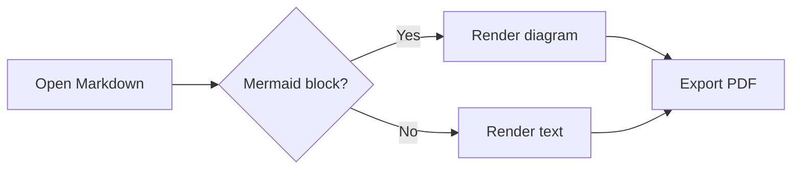
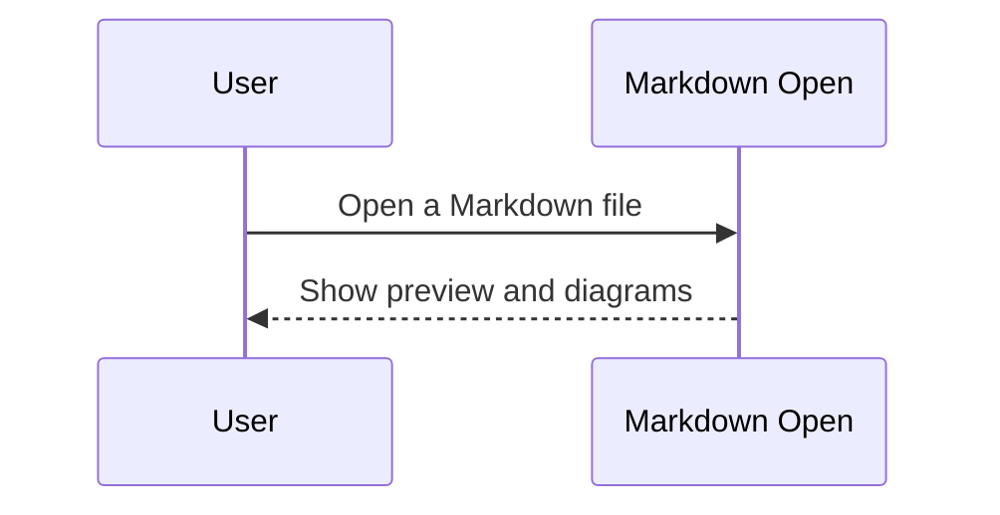

# Welcome to Markdown Open 🎉

This is a **sample** markdown file to test the viewer.

## Features

- [x] Live markdown preview
- [x] Syntax highlighting
- [x] Drag & drop file
- [x] PDF export
- [x] Offline Mermaid diagrams

## Code Example

```typescript
function greet(name: string): string {
  return `Hello, ${name}!`
}

console.log(greet("World"))
```

```python
def fibonacci(n: int) -> list[int]:
    a, b = 0, 1
    result = []
    for _ in range(n):
        result.append(a)
        a, b = b, a + b
    return result

print(fibonacci(10))
```

## Mermaid Diagram





## Blockquote

> The best way to predict the future is to create it.
> — Peter Drucker

## Table

| Library | Version | Size |
|---------|---------|------|
| React | 18.x | ~6 KB gzip |
| markdown-it | 14.x | ~40 KB |
| highlight.js | 11.x | ~120 KB |

## Nested List

1. Setup
   - Install dependencies
   - Configure Vite
2. Development
   1. Write components
   2. Add styling
   3. Test manually
3. Deploy

---

*Enjoy!*
